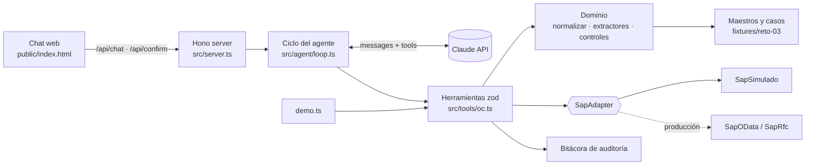

# SOLUCIÓN — Agente de Órdenes de Compra (Reto 3)

> ✏️ = completar/ajustar durante el reto con los datos reales del PRD y los fixtures.

## 1. Resumen

Agente conversacional en TypeScript (Bun) que lee solicitudes de compra, extrae datos de la cotización/factura, ejecuta una matriz de **15 controles deterministas** contra los maestros corporativos y crea la orden de compra en un SAP simulado **solo tras confirmación humana**.

Principio de diseño: **el LLM orquesta y explica; el código decide.** Toda regla de negocio vive en funciones puras testeables; el modelo solo elige qué herramienta llamar y redacta la respuesta. Por eso `demo.ts` procesa los casos sin modelo y obtiene exactamente las mismas decisiones.

- URL pública: ✏️
- Repositorio: ✏️
- Resultado de `bun demo.ts`: ✏️ N/6 casos coinciden con lo esperado.

## 2. Arquitectura

| Capa | Archivo | Responsabilidad |
|---|---|---|
| Prompt | `agent/prompt.md` | Rol, flujo obligatorio, reglas no negociables, formato |
| Herramientas | `src/tools/oc.ts` | Contrato zod de cada acción; `requiresConfirmation` en las que escriben |
| Ciclo | `src/agent/loop.ts` | Loop tool-use, pausa/reanudación por confirmación, límite de pasos |
| Dominio | `src/domain/*.ts` | Normalización de esquemas, extracción por regex con confianza, motor de controles |
| Datos | `src/data/maestros.ts` | Carga tolerante de maestros/casos; búsquedas (NIT con/sin DV) |
| SAP | `src/sap/*.ts` | Puerto `SapAdapter` + implementación simulada (idempotente) |
| UI | `public/index.html` | Chat, tarjetas de tool calls, tarjeta de confirmación con payload |

## 3. Ciclo del agente

1. El usuario escribe ("procesa sol-003").
2. El backend llama al modelo con system prompt (cacheado) + definiciones de herramientas (JSON Schema generado desde zod).
3. Si el modelo responde `tool_use`, cada llamada se valida con zod y se ejecuta; el resultado vuelve como `tool_result`.
4. **Gate humano:** si la herramienta tiene `requiresConfirmation` (`crear_orden_compra`), el loop **pausa**, guarda el estado (llamadas restantes y resultados parciales) y la UI muestra una tarjeta con decisión, alertas y payload calculado. Al aprobar/rechazar, el loop reanuda exactamente donde quedó.
5. Al confirmar, la herramienta **re-evalúa los controles en el backend** antes de escribir en SAP: el modelo no puede crear una OC rechazada aunque lo intente (probado en `demo.ts`).
6. El ciclo termina cuando el modelo responde sin `tool_use` o al llegar al límite de pasos (`MAX_PASOS`).

Decisiones clave:
- **El modelo solo pasa IDs**, nunca montos ni datos maestros → elimina alucinación de cifras en la OC.
- **Defensa en profundidad:** prompt (no crear si rechaza) + confirmación humana + re-validación en la herramienta.
- **Idempotencia** por `referenciaExterna = id de solicitud` → reintentos o doble clic no duplican OCs.

## 4. Matriz de controles

Decisión: cualquier BLOQUEANTE en FALLA → **RECHAZAR**; si no, cualquier ALERTA en FALLA o control en REVISAR → **REVISION_HUMANA**; si no → **APROBAR**.

| ID | Control | Severidad | Fuente | Regla |
|---|---|---|---|---|
| C01 | Proveedor existe | Bloqueante | proveedores.json | NIT de solicitud/cotización en maestro (tolera DV) |
| C02 | Proveedor activo | Bloqueante | proveedores.json | estado ∈ {ACTIVO, HABILITADO} |
| C03 | NIT cotización = proveedor | Bloqueante | cotizacion.txt | Detecta cotización de un tercero |
| C04 | Centro de costo válido | Bloqueante | centros-costo.json | Código existe |
| C05 | Subárea pertenece al centro | Bloqueante | centros-costo.json | |
| C06 | Evidencia de aprobación | Bloqueante | aprobacion.json | Existe y decisión = aprobado |
| C07 | Aprobador es líder del centro | Bloqueante | centros-costo.json | Segregación: aprueba quien tiene la atribución |
| C08 | Monto ≤ tope del líder | Bloqueante | centros-costo.json | ✏️ confirmar si es con o sin IVA |
| C09 | Monto aprobado cubre la compra | Bloqueante | aprobacion.json | Evita aprobar X y comprar X+n |
| C10 | Indicador IVA válido | Bloqueante | indicadores-iva.json | Solicitud o default del proveedor |
| C11 | IVA cotización cuadra con tasa | Alerta | cotizacion.txt | Tolerancia 1 peso o 0,1% |
| C12 | Total cuadra con cotización | Bloqueante | cotizacion.txt | |
| C13 | Condición de pago válida | Bloqueante | condiciones-pago.json | Solicitud o default del proveedor |
| C14 | Cotización vigente al aprobar | Alerta | cotizacion.txt | fecha + validez ≥ fecha aprobación |
| C15 | Compra no retroactiva | Alerta → revisión | factura.txt | Factura existente antes de la OC |

Resultados por caso: ✏️ pegar la tabla de `bun demo.ts`.

| Caso | Decisión | Controles en falla | OC |
|---|---|---|---|
| sol-001 | ✏️ | | |
| … | | | |

## 5. Diseño del adaptador SAP real (producción)

El agente depende solo del puerto `SapAdapter` (`crearOrdenCompra`, `consultarPorReferencia`). Para producción se implementa un adaptador sin tocar herramientas ni agente.

**Opción A — S/4HANA (recomendada): OData `API_PURCHASEORDER_PROCESS_SRV`** (o su sucesora OData V4 de Purchase Order).
- `GET` con `x-csrf-token: fetch` → `POST /A_PurchaseOrder` con deep insert de cabecera + posiciones + imputación (`to_PurchaseOrderItem` / `to_AccountAssignment`).
- Autenticación: OAuth 2.0 client credentials vía SAP BTP / API Management; usuario técnico con rol restringido a creación de pedidos en las sociedades/organizaciones necesarias.
- Si el backend es on-premise: SAP Cloud Connector como túnel; nunca exponer el ERP.

**Opción B — ECC / on-premise: RFC `BAPI_PO_CREATE1` + `BAPI_TRANSACTION_COMMIT`** (vía conector RFC o middleware como SAP PI/PO, CPI o MuleSoft). Se leen los mensajes de `RETURN` (BAPIRET2): tipo `E`/`A` = error → rollback (`BAPI_TRANSACTION_ROLLBACK`).

**Mapeo de campos**

| Agente | SAP (tabla-campo) |
|---|---|
| proveedor | Proveedor `LIFNR` (EKKO) — mapeo NIT → LIFNR vía maestro |
| clase de documento | `BSART`: `NB` estándar; ✏️ `ZRET` propuesta para regularizaciones |
| sociedad / org. compras / grupo | `BUKRS` / `EKORG` / `EKGRP` (parámetros por configuración) |
| condición de pago | `ZTERM` |
| moneda | `WAERS` |
| posición | `TXZ01`, `MENGE`, `NETPR`, `MWSKZ` (indicador IVA) |
| imputación | `KNTTP = K` (centro de costo), `KOSTL` |
| referencia externa | `IHREZ` "Su referencia" o campo Z de cabecera → llave de idempotencia |

**Confiabilidad**
- **Idempotencia:** antes de crear, buscar pedido por la referencia externa; si existe, devolverlo (mismo contrato que el simulado).
- **Outbox transaccional:** la intención de crear la OC se persiste en BD y un worker la envía; reintentos con backoff exponencial solo ante errores transitorios (timeouts, 5xx, bloqueos). Errores funcionales (`E` de BAPIRET2) no se reintentan: vuelven al agente como mensaje para el humano.
- **Circuit breaker** si SAP no responde; el agente informa "SAP no disponible, la OC quedó en cola".
- **Observabilidad:** correlation-id del chat → pedido SAP; trazas de cada tool call; bitácora inmutable (quién confirmó, cuándo, con qué payload).
- **Seguridad:** secretos en vault; mínimo privilegio; el LLM jamás ve credenciales ni llama a SAP directo.
- **Pruebas:** contrato del adaptador probado contra sandbox SAP (o mock del servicio OData) con los mismos 6 casos de `demo.ts`.

## 6. Análisis crítico: el desvío de las compras retroactivas

**Qué se observó.** ✏️ En N de 6 casos existe factura del proveedor **antes** de que exista la OC (y en ✏️ casos, antes incluso de la aprobación del líder). Es decir, el bien o servicio ya se compró y la OC se crea para "legalizar".

**Por qué importa (más allá del trámite)**
- **El control de aprobación se vuelve decorativo:** el líder aprueba un gasto ya comprometido; ya no puede decir que no.
- **Presupuesto invisible:** el compromiso no se registró en su momento → el centro de costo se ve con más disponibilidad de la real.
- **El 3-way match pierde sentido:** OC, recepción y factura deberían validar cosas distintas; si la OC se construye copiando la factura, coinciden por construcción.
- **Riesgo de fraude y de proveedor:** compras fuera de proceso evaden la verificación de proveedor activo, cotizaciones comparativas y topes. Es un hallazgo típico de auditoría/revisoría fiscal.
- **Riesgo tributario/contable:** gastos causados sin soporte de compra previo y diferencias de período.

**Causas probables** (✏️ validar con datos): urgencias operativas reales sin un canal rápido; proceso de OC percibido como lento; proveedores recurrentes sin contrato marco; falta de consecuencias ("siempre se legaliza").

**Qué hace el agente hoy**
- Detecta (C15) y **nunca** regulariza en automático: exige decisión humana + justificación escrita.
- Crea la OC con clase de documento distinta (`ZRET` en el simulado) → las retroactivas quedan **medibles** en SAP.
- Registra la justificación en la bitácora y sugiere escalar a control interno.

**Recomendaciones de proceso**
1. Política **"No PO, no pay"**: cuentas por pagar no paga facturas sin OC previa, salvo excepción aprobada por un nivel superior al líder.
2. **Canal de urgencia** real: aprobación exprés (móvil/chat, SLA de horas) para que la urgencia no justifique saltarse el proceso.
3. **Contratos marco / pedidos abiertos** para proveedores recurrentes: la OC existe antes del consumo.
4. **KPI** mensual de % de compras retroactivas por centro de costo y líder; meta de reducción y revisión en comité.
5. Escalamiento automático a control interno cuando un mismo centro supera un umbral de retroactivas.

## 7. Costos del modelo (estimado)

✏️ Medir con el contador de tokens del chat (cabecera) y completar.

| Concepto | Valor |
|---|---|
| Tokens entrada por solicitud (prompt + tools + resultados) | ✏️ |
| Tokens salida por solicitud | ✏️ |
| Costo por solicitud | ✏️ |
| Palancas | prompt caching del system prompt + tools; resultados de herramientas compactos; modelo pequeño para casos APROBAR sin alertas; el trabajo pesado (controles) no consume tokens |

## 8. Limitaciones y siguientes pasos

- Extracción por regex: robusta para formatos conocidos; en producción, OCR + extracción con LLM **solo** para el texto, con validación cruzada por los controles deterministas.
- Estado en memoria (sesiones, SAP simulado, bitácora): en producción → Postgres/Redis.
- Sin autenticación de usuarios en el chat: en producción, SSO y la confirmación queda firmada por el usuario autenticado.
